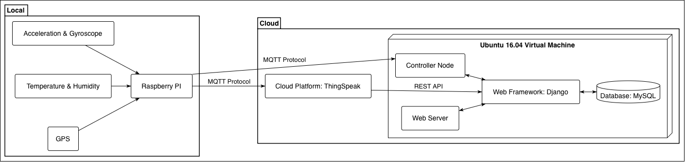

# Django IoT Shipment Tracker

> 🚧 **Status: Work in Progress** - Currently in active development during the university semester.

> **Academic Project** - End-to-End IoT Telemetry & Web Dashboard

An end-to-end IoT shipment monitoring system designed to track high-value or fragile cargo. A Raspberry Pi edge node collects real-time GPS coordinates, acceleration (shock/vibration), and environmental data (temperature/humidity). The telemetry is streamed via MQTT to a cloud platform and visualized in a custom Python/Django web application featuring a real-time dashboard and mapping integration.

## 1. Core Features
- **Live Location Tracking:** Integrates serial GPS data with the Google Maps JavaScript API for real-time asset localization.
- **Condition Monitoring:** Tracks ambient temperature and humidity to monitor sensitive shipments and prevent cargo spoilage.
- **Shock & Tilt Detection:** Utilizes I2C-based accelerometer and gyroscope data to detect mishandling during transit.
- **Cloud Telemetry:** Reliable data ingestion and time-series storage using ThingSpeak (MQTT/REST) as the IoT broker.

## 2. Tech Stack & Architecture
**Hardware & Edge Node:**
- Raspberry Pi 3/4
- I2C Sensors: Temperature & Humidity, Acceleration & Gyroscope
- Serial Interface: GPS Module
- Edge Software: Python (Paho-MQTT, Requests)

**Cloud & Messaging:**
- ThingSpeak Cloud Platform 
- MQTT Protocol & REST API

**Web Backend (Full-Stack):**
- Python / Django Framework (MVC Architecture)
- MySQL Database
- Frontend: HTML5, CSS (Bootstrap), Google Maps API

## System Architecture

## 3. System Data Flow
1. **Data Acquisition:** Python scripts on the Raspberry Pi read sensor registries via the I2C bus and parse NMEA sentences from the serial GPS module.
2. **Ingestion:** The payload is formatted into JSON and published to ThingSpeak channels via MQTT over WebSockets.
3. **Presentation Layer:** The Django application fetches the latest telemetry via REST, updates the local relational database, and renders a dynamic dashboard with an interactive geographic map.

## 4. Security Note
All API keys (ThingSpeak Read/Write keys, Google Maps API key) and the Django `SECRET_KEY` are strictly managed via local environment variables (`.env`) and excluded from version control.
